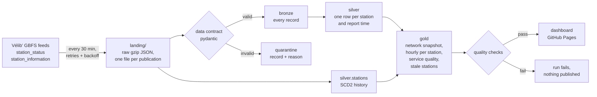

# velib-pipeline

[](https://github.com/Adversitas/velib-pipeline/actions/workflows/ci.yml)
[](https://github.com/Adversitas/velib-pipeline/actions/workflows/pipeline.yml)

**Live dashboard, refreshed every 30 minutes by the scheduled pipeline → [adversitas.github.io/velib-pipeline](https://adversitas.github.io/velib-pipeline/)**

**An incremental data pipeline on a live, imperfect source: the Vélib' Métropole bike-share open-data feeds (1,522 stations around Paris). It covers:**
- API ingestion into an immutable landing zone
- data contracts with quarantine
- DuckDB bronze/silver/gold layers, incremental and transactional, with type-2 history of stations
- quality checks that block publication when the data can't be trusted
- the same steps as a GitHub Actions schedule and as an Airflow DAG

> **En bref (FR)** : pipeline de données incrémental sur les flux ouverts temps réel de Vélib' Métropole. Il comprend :
> - une ingestion API idempotente vers une zone d'atterrissage immuable ;
> - des contrats de données avec quarantaine ;
> - des couches bronze/silver/gold dans DuckDB (chargement transactionnel, historisation SCD2 des stations) ;
> - des contrôles qualité qui bloquent la publication, une orchestration planifiée (GitHub Actions, avec un DAG Airflow équivalent) et un tableau de bord publié automatiquement.
>
> Pendant le développement, le producteur a publié un instantané dégradé ; l'incident et la manière dont le pipeline l'a absorbé sont documentés ci-dessous.

## Architecture



| Stage | Guarantees | Code |
|---|---|---|
| Ingestion | Files are named by the feed's own publication timestamp, so fetching the same publication twice writes it once. Writes are atomic (temp file + rename), and transient HTTP errors are retried with backoff. Raw files are never modified, so everything downstream can be rebuilt from them. | [`ingest.py`](src/velib/ingest.py) |
| Contracts | Types, non-negative counts, the bike-type breakdown adding up to the total, plausible timestamps and coordinates. Invalid records go to `quarantine.records` with the reason; nothing is dropped silently. | [`contracts.py`](src/velib/contracts.py) |
| Loading | Only files absent from `meta.ingestion_log` are processed, each in its own transaction, so a crash leaves no partial file and the next run resumes. Silver de-duplicates the feed's repetition (63% of raw records are unchanged re-publications). Stations are type-2 historised on name, capacity and position. | [`load.py`](src/velib/load.py) |
| Quality | Freshness, volume, quarantine rate of the latest publication, referential integrity, capacity consistency, stale stations, missing attributes, silver uniqueness. A `fail` stops the run before the dashboard is published. | [`quality.py`](src/velib/quality.py) |
| Orchestration | GitHub Actions schedule (every 30 min, single writer via `concurrency`, lake persisted in the Actions cache). The [Airflow DAG](dags/velib_pipeline.py) runs the same functions with retries, and fails on quality checks without retrying. | [`pipeline.yml`](.github/workflows/pipeline.yml) |

## What the live data taught the pipeline

Real feeds are where data contracts earn their keep. Three findings from building this against the live API:

**1. A degraded publication (12 Nov 2026, 18:04 UTC).**

The producer published one snapshot in which every station had `stationCode: null` and an empty bike-type breakdown (`[{}, {}]`). The next publication was healthy again.

- The first version of the contract rejected all 1,522 stations of that snapshot, and the loader then crashed on an empty insert. A test now covers that bug.
- The fix distinguishes **missing** from **wrong**. A missing code keeps the station's last known code (no false SCD2 version), and a missing breakdown makes the e-bike count unknown for that snapshot. A breakdown that is present but contradicts the total is still rejected.
- Two quality checks (`station_code_missing`, `bike_types_missing`) now surface the incident, and regression tests replay it.

**2. Stations that stopped reporting years ago are still published.**

18 stations in the live feed have been silent for more than a day. The oldest last reported in **February 2021**, 2,090 days before the run. They are counted in "available" docks unless excluded, so `gold.stale_stations` lists them for operations, and the dashboard shows them.

**3. Capacities beyond the obvious bound.**

The first contract capped capacity at 200 docks, which quarantined two real stations (Invalides – Quai d'Orsay with 410 and Concorde with 409, temporary event stations). The bound is now 500. That still catches unit errors, without rejecting real infrastructure.

## Run it

```bash
git clone https://github.com/Adversitas/velib-pipeline.git
cd velib-pipeline
python -m venv .venv && source .venv/bin/activate      # Windows: .venv\Scripts\activate
pip install -e ".[dev]"

velib run            # ingest + load + checks + dashboard (site/index.html)
velib check          # quality checks only; exit code 1 on failure
pytest               # 17 tests on synthetic feeds: no network needed
```

Run `velib run` a few times, a few minutes apart, to see the incremental load (only new files are processed) and the silver de-duplication at work. In the warehouse (`lake/warehouse.duckdb`):

```sql
SELECT * FROM gold.network_snapshot ORDER BY published_at;      -- network state per publication
SELECT * FROM gold.station_service ORDER BY share_empty DESC;    -- where users find no bike
SELECT * FROM gold.stale_stations;                               -- silent stations
SELECT * FROM quarantine.records;                                -- what broke the contract, and why
SELECT * FROM silver.stations WHERE NOT is_current;              -- station history (SCD2)
```

## Design decisions

- **Land first, transform later.** The raw publication is the system of record. A bug in a transformation is fixed by changing the code and re-running on the landing zone, with no re-fetching (the API has no history).
- **Idempotence everywhere.** Landing is keyed by publication time, loading by file, and silver by (station, report time). Retries, overlapping schedules and backfills can't create duplicates; the tests check each of these.
- **A failed check stops publication, not ingestion.** Raw data is always landed, even on a bad day, so the evidence is kept. Only the dashboard is withheld until the data is trustworthy again.
- **Gate on the latest publication.** The quarantine rate is judged on the newest snapshot. One past incident should not keep the pipeline red forever; its records stay in quarantine for inspection.
- **No raw data in the repository.** The feeds are fetched live, and only aggregates are published. In production, the landing zone would be object storage (S3, ADLS, GCS) instead of the Actions cache.

## Limitations

- The Actions cache is a convenient free store, not a durable one. GitHub evicts caches unused for 7 days and pauses schedules on inactive repositories, so a real deployment would land to object storage.
- DuckDB is single-writer, which the schedule respects (`concurrency`, `max_active_runs=1`). A multi-team platform would use a warehouse, and the same SQL ports to it.
- The feed reports only current state; trips and rebalancing operations are not observable, so "station empty" means that no bike was available, not that one was requested.

## License

Code: MIT. Data: Vélib' Métropole open-data GBFS feeds (© Smovengo / Syndicat Autolib' Vélib' Métropole); see the producer's terms of use. No raw data is redistributed here.
